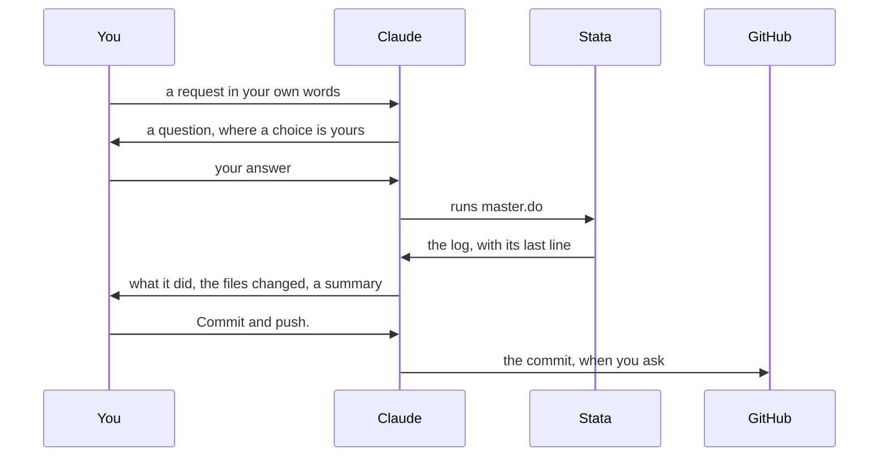

# Working with Claude

On this platform, Claude does the technical steps and people decide.

## What Claude is here, and how to ask

Claude is an AI model made by Anthropic. You work with it in Claude Code, a program on your own machine. You open a session on one project's folder and write as you would to a colleague, as in "This number looks wrong."

Each project holds written instructions for Claude: the rules in `AGENTS.md`, which `CLAUDE.md` loads, and the procedures of rarer tasks in `.claude/`. So a request such as "Run everything." means the same on every machine.

Beyond a project's own files, the handbook website publishes `llms-full.txt` (every page in one file) and `llms.txt` (the page list) beside the start page. A project's own instructions still come first wherever the handbook differs.

## How a task goes

`master.do` is the one file that runs a project. Every task ends with the files changed and a summary of one line.

## What stays yours

- **Scientific choices.** Claude asks, and records your answer in the file `decisions.md` with your words, your name and the date.
- **Reading the results,** licences, and each decision in an assistant's review sheet.

## What Claude never does

- It never commits or pushes on its own, and never releases a dataset without asking.
- It never decides a scientific choice unless you hand it over, as in "You decide.", and it then marks the choice as provisional. The choices of an old project that you move in stay as the old code had them, also marked provisional, until you confirm them.
- It never edits delivered data, released data, or a table that a person made.
- It never invents a finding. A result comes from code that `master.do` ran.
- It never runs an installer on your machine. Whatever needs an installer, administrator rights or a sign-in, you do.

## How you keep control

Claude can be wrong. Four things stand between a mistake and a paper:

1. **Records.** Each task ends with the files changed. Each run leaves a dated log unless a check stops it before `master.do` opens one. Each choice adds a row to `decisions.md`, and each commit adds a line to GitHub's history.
2. **Full runs.** A result comes only from code that `master.do` ran, and a full run makes every table and figure afresh.
3. **Reviews.** On request, Claude checks the code, and each number typed in the paper, against a written checklist.
4. **People.** Before submission, a colleague reruns the project from a fresh copy, and a person reads the paper in full. No program enforces this rule.

## Locks and instructions

A setting is a lock: Claude Code refuses the command, or asks you first, whatever Claude intends. In the repo that makes the shared data, a setting refuses Claude's own edit of a file under the data root's `processed/`. A setting matches a command's wording, so the same action inside a script gets past it.

An instruction is what Claude is told. Claude follows an instruction without a hard guarantee. Most rules here are instructions. The question before a release is one too, and a setting backs it only where Claude Code applies that setting.

## Where Claude is not used

A replication package for a journal runs without Claude, because the journal's replicator has none.

Claude Code sends what Claude reads to Anthropic's servers. Where a provider's terms bar that, Claude's instructions keep the source's files closed, with [gaps that remain](../data/terms-of-use.md#sources-that-may-not-reach-an-outside-service).
