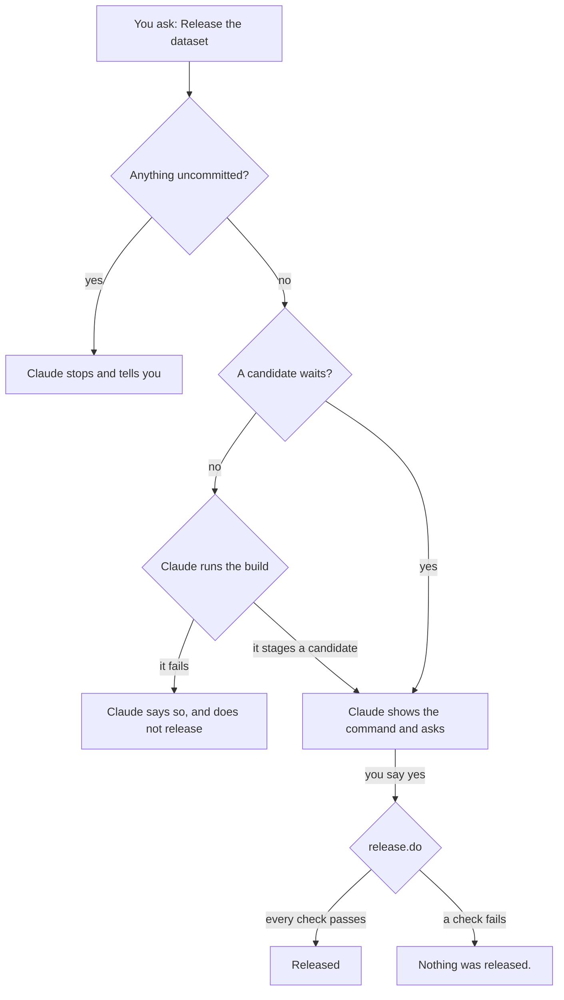

# Release a version

A release publishes a build's candidate as a version, `v<N>`, that every project can pin. A version cannot be changed afterwards, so Claude asks you first.



## Before you ask

- Commit and push everything in `data-processing`.
- If a candidate waits, Claude releases that one and does not rebuild. A rebuild would replace a candidate that someone may have looked over.
- If a review sheet was filled since the last build, [ask for the build first](run-a-review-round.md#apply-the-filled-sheet).

## Ask Claude to release it

**Ask Claude.** In `data-processing`:

```prompt
Release <dataset>.
```

**Claude will ask you.** For your yes to `release.do`, in a message that shows the command. `<N>` is one more than the dataset's highest released version.

**Check.** The release ends with these two lines:

```text
Released <dataset> v<N> to <folder> (build commit <commit>).
Next: add one line to builds/<dataset>/README.md, what changed in v<N>; commit, push, and tell the chair.
```

**Only you do.** Add that line to the build's `README.md`, [commit and push](commit-and-push.md), and tell the chair: the researchers who read the dataset.

Every refusal ends `Nothing was released.` Claude reports [the sentence](../reference/messages-build-and-release.md#a-release) and does not work around it.

**What can go wrong.**

- Every member can write `intermediate/`, so a staged file can change before the release. Nothing guards against it.
- On Windows, Claude's question may rest on its instructions alone. Claude Code's documentation says that, with Git for Windows installed, the setting behind the question can match nothing. No trial has checked this.
