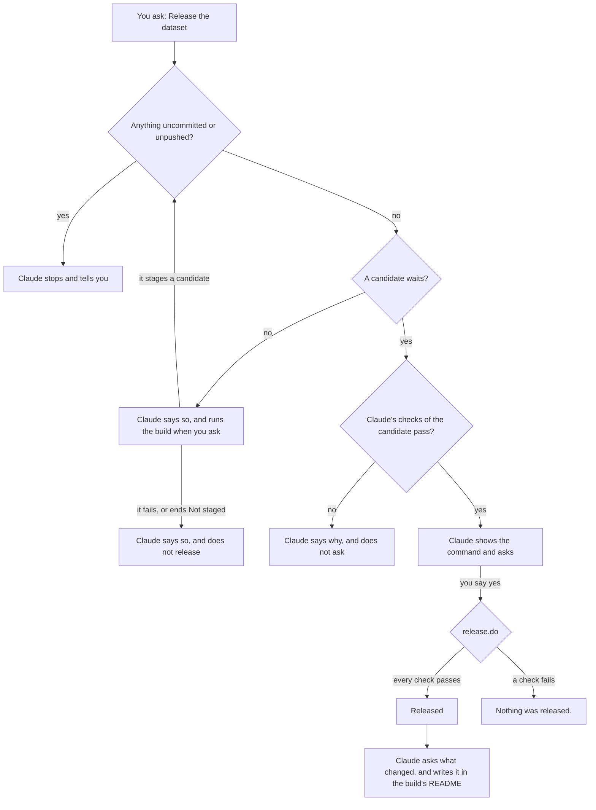

# Release a version

A release publishes a build's candidate as a version, `v<N>`, that every project can pin. A version cannot be changed afterwards, so Claude asks you first. Claude follows its skill `release`.



Claude's checks of a waiting candidate: its `staged.txt` holds a fingerprint, a value computed from every file of the code that made it, which changes when any of those files changes; and its files are not, byte for byte, what the highest version already holds.

## Before you ask

- A build may run before or after its code is committed. Its candidate is released only once that code is committed and pushed exactly as it was when the build ran. `release.do` refuses the candidate if the code that makes the dataset changed since the build.
- That code is the build's `code/` (except its logs and `code/explore/`), `code/build.do`, `ado/`, and the first line and the dataset's rows of `datamap.csv`. A README, `decisions.md`, another build or a raw source's row is not, so committing them leaves a candidate releasable.
- If a candidate waits and passes Claude's checks, Claude asks for your yes to release that one, and does not rebuild. A rebuild would replace a candidate that someone may have looked over.
- If a review sheet was filled since the last build, [ask for the build first](run-a-review-round.md#apply-the-filled-sheet).

## Ask Claude to release it

**Ask Claude.** In `data-processing`:

```prompt
Release <dataset>.
```

**Claude will ask you.** For your yes to `release.do`, in a message that shows the command. `<N>` is one more than the dataset's highest released version. After the release, what changed in this version.

**Check.** The release ends with these two lines:

```text
Released <dataset> v<N> to <folder> at commit <commit>, the commit checked out.
Next: add one line to builds/<dataset>/README.md, what changed in v<N>; commit, push, and tell the chair. A README does not make a dataset: that commit leaves a candidate that waits releasable.
```

Claude writes your words as the version's line in the build's `README.md`, shows it, and commits and pushes it when you ask. If another candidate waits, Claude proposes to release it next. It then names each build that pins the dataset; each moves to the new version only when you ask Claude to change its pin.

**Only you do.** Tell the chair: the researchers who read the dataset.

Every refusal ends `Nothing was released.` Claude reports [the sentence](../reference/messages-build-and-release.md#a-release) and does not work around it.

**What can go wrong.**

- Every member can write `intermediate/`, so a staged file can change before the release. `release.do` notices only a change made while it runs.
- `release.do` cannot see code that was uncommitted when the build ran and is still uncommitted at the release. Only Claude's first check, that nothing is uncommitted, covers it.
- On Windows, Claude's question may rest on its instructions alone. Claude Code's documentation says that, with Git for Windows installed, the setting behind the question can match nothing. No trial has checked this.
