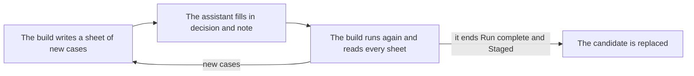

# Run a review round

Some cases cannot be decided by code, such as an uncertain match. An assistant decides them in an Excel sheet, and the build's next run reads the decisions.



## Let the build write the sheet

A full run writes each case that no sheet lists yet into a new sheet, in `intermediate/<dataset>/`. Claude reports the line that names the sheet.

If this machine cannot write that folder, the sheet goes to the build's `logs/`. When you ask, Claude copies it into `intermediate/<dataset>/` if this machine can write that folder; if it cannot, Claude says so.

Tell the assistant, whose page is [Fill in a review sheet](../assistant/fill-in-a-review-sheet.md). The sheet stays in its folder.

## Apply the filled sheet

**Ask Claude.** In `data-processing`:

```prompt
The assistant has filled the sheet for <dataset>. Apply it.
```

Claude runs the whole build. Only a run that ends `Run complete` and `Staged` replaces the candidate, and a run stages on the data curator's machine alone. The build saves the decisions it used as the file `decisions`, which is released with the version.

**Check.** Claude reports these two lines:

```text
Review sheets: <n> read. Cases: <n>. Decided: <n> (<n> yes, <n> no). Not decided yet: <n>.
Decisions that match no current case, not used: <n>.
```

The build stops on a sheet with a wrong entry, and on two sheets that decide one case differently. Claude says which sheets. See [A review round](../reference/messages-build-and-release.md#a-review-round). The assistant corrects them in Excel; then ask for the build again.

**Only you do.** For a source whose terms [bar outside services](../data/terms-of-use.md#sources-that-may-not-reach-an-outside-service), or say not to open its files, read in the build's log which sheets they are.
