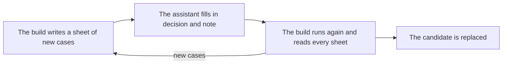

# Run a review round

Some cases cannot be decided by code, such as an uncertain match. An assistant decides them in an Excel sheet, and the build's next run reads the decisions.



## Let the build write the sheet

A full run writes each case that no sheet lists yet into a new sheet, in `intermediate/<dataset>/`. Claude reports the line that names the sheet.

Tell the assistant, whose page is [Fill in a review sheet](../assistant/fill-in-a-review-sheet.md). The sheet stays in its folder.

## Apply the filled sheet

**Ask Claude.** In `data-processing`:

```prompt
The assistant has filled the sheet for <dataset>. Apply it.
```

Claude runs the whole build. On your machine, that run replaces the candidate. The build saves the decisions it used as the file `decisions`, which is released with the version.

**Check.** Claude reports these two lines:

```text
Review sheets: <n> read. Cases: <n>. Decided: <n> (<n> yes, <n> no). Not decided yet: <n>.
Decisions that match no current case, not used: <n>.
```

The build stops on a sheet with a wrong entry, and on two sheets that decide one case differently. Claude says which sheets, and the assistant corrects them in Excel. Then ask for the build again. See [A review round](../reference/messages-build-and-release.md#a-review-round).
