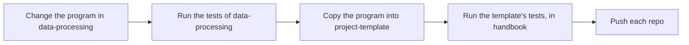

# Test and copy a changed chair program

`data-processing` stores the chair's five Stata programs in `ado/c/`. `project-template` holds a copy of three, `chair_use`, `chair_rstep` and `chair_results`; `chair_commit.ado` and `chair_fingerprint.ado` are in `data-processing` alone, and `chair_pystep`, `chair_save`, `chair_merge`, `chair_append`, `chair_flow` and `chair_after` in `project-template` alone. After a change, both repos must pass their tests, and each copy must stay identical to its source.



## Run the tests of `data-processing`

**Ask Claude.** In `data-processing`:

```prompt
Run the tests.
```

**Check.** Claude gives the count from this line and quotes any failure in full:

```text
data tests: <n> passed, <n> failed (results.txt)
```

Claude never edits a file under `tests/` on its own or on a general yes to fix a failure. It changes one only when you explicitly ask for that change (aside from copying a changed template from `code/templates/` into `tests/fixtures/builds/`).

## Copy the program into `project-template`

Claude tells you that `project-template/ado/c/`, in the clone beside this one, needs the same file. It copies only when you ask, for example:

```prompt
Copy the changed program into project-template.
```

## Run the template's tests

**Ask Claude.** In `handbook`, which holds the template's tests:

```prompt
Run the tests.
```

**Check.** Claude reports the counts from this line, and says why any case was skipped:

```text
template tests: <n> passed, <n> failed, <n> skipped (results.txt)
```

**Only you do.** On Windows, batch mode skips each R case. To run them, start the tests in Stata's window, with the network on and the R version of the template's `renv.lock`.

**Untested on Windows.** Nobody has yet run the R cases this way on a university Windows machine.

Push each repo only if no test failed. A project made earlier keeps its old copy of the program, because shared code is copied, not linked.
