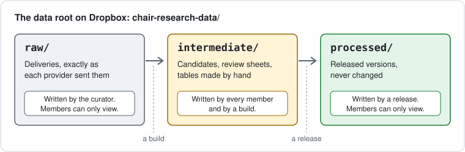

# The data root

The data root is the one folder that holds the chair's shared data: `chair-research-data`, on Dropbox.

Each machine names its place in the data-root file: `chair-research-data.txt` in the home folder, `C:/Users/<you>/`. The file has one line, the data root's full path on that machine.

## The three folders

| Folder | Holds | Who writes |
|---|---|---|
| `raw/<source>/<date>/` | A delivery: a source's files as the provider sent them. | Claude, on the data curator's machine and word, copies a delivery there untouched. Nobody edits a file there. |
| `intermediate/<dataset>/` | A build's candidate and review sheets, and any table made by hand for the build. | A build, an assistant in Excel, a member by hand, or Claude when asked to copy a table there. |
| `intermediate/<project>/` | Tables made by hand for one project. | A member by hand, or Claude with the member's yes. |
| `processed/<dataset>/v<N>/` | A released version: `.dta` files and `manifest.txt`. | A release, on the data curator's machine. |

Members can view `raw/` and `processed/` but cannot edit them. Every member can write `intermediate/`.

**Untested on Windows.** The Dropbox team account is not yet set up, so nobody has tried these access rights.

A project writes one thing into the data root: a table made by hand for that project. Its working files, logs and exhibits stay [in its clone](../reference/folders.md#a-project).
