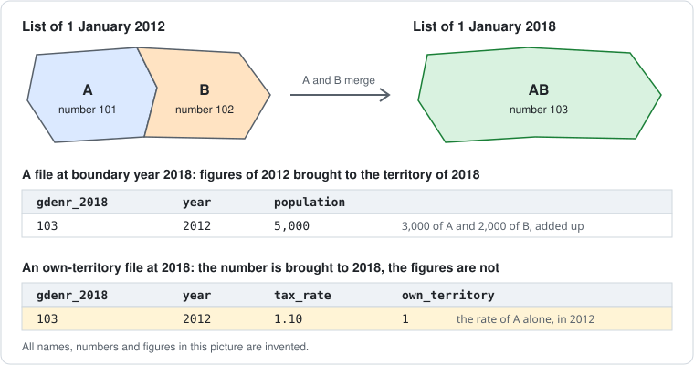

# Municipal data and boundary years

Municipalities merge and split, so one number can mean different territories in different years. The shared data states which territory each file uses.

## Standard keys

| Variable | Meaning |
|---|---|
| `gdenr_<yyyy>` | The municipality's number on the list of 1 January `<yyyy>` that `<source>` publishes |
| `year` | The year of the figures, in a panel |
| `ctn` | The region that the municipality belongs to at that boundary year |

## A boundary year

A boundary year is one state of the municipalities: the list in force on 1 January of that year. Each processed municipality file uses one boundary year, which its key's name shows.

Two files with the same `gdenr_<yyyy>` merge in one line.

## Own-territory files

Some sources give no figures for a municipality that was later absorbed. Their numbers can be brought to a boundary year, but their figures cannot: they cover each year's own territory. The data map marks such a file as `<yyyy>, own territory`.

Such a file has the variable `own_territory`. It is 1 on a row whose figures cover another territory than the municipality's at `<yyyy>`.

A merge with such a file sets two territories side by side on its flagged rows. So the code tabulates `own_territory` against the merge's result, and Claude says how many matched rows are flagged. The researcher decides what to do with them.

## The municipality register

The municipality register is the first processed dataset. For each boundary year it holds the numbers, names and regions valid then, and the crosswalk between boundary years. Each January's list leads to a new version. A release checks a file's municipality numbers against it.
