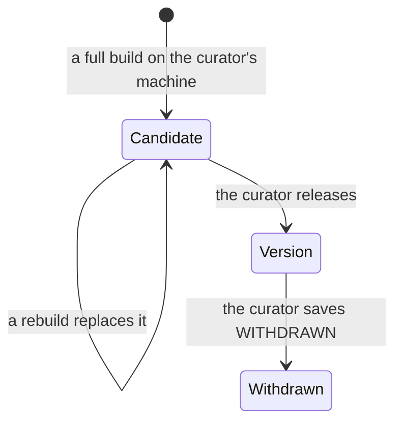

# Versions and pins

A dataset is released in versions, and each project names the version it reads.

## A version

A version is the folder `processed/<dataset>/v<N>/` in the data root. It holds the dataset's `.dta` files and `manifest.txt`, which gives the version's date, its files, and the commit of the build that made them. A version is never changed.

A release writes the manifest last. A folder that has none is a release that stopped part-way, and nothing loads from it.

## A candidate is not a version



A candidate is a build's finished files. It waits in `intermediate/<dataset>/`, where `staged.txt` lists its files, its commit and its date. No project can pin a candidate.

## A pin

A pin is a line in a project's `code/pins.do`. There are two kinds.

```stata
global pin_<dataset> "v<N>"
global raw_<name> "<source>/<date>"
```

The first names a dataset's version, the second a raw delivery. A hyphen in the dataset's name is written `_` in the pin. Each name has one line: a second line for the same name stops the run.

## Which version a run read

A run's log shows each pin that the run read, and a line of `chair_use`, the loading command, for each file.

```text
pins.do: <pin> "<value>"
chair_use: <dataset>/<file> v<N>
```

## A withdrawn version

A withdrawn version holds a file named `WITHDRAWN`, with the data curator's reason and the version to use. It loads as before, so old results can be reproduced. Each load prints [a warning](../reference/messages-project-run.md#loading-a-dataset) and the data curator's text.
