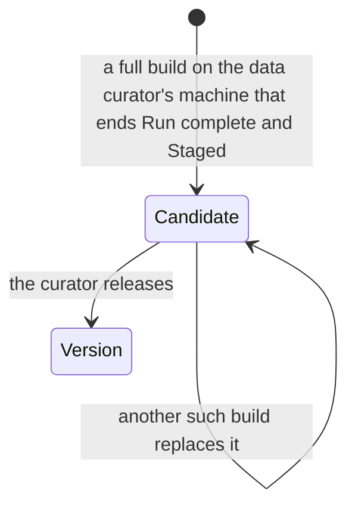

# Versions and pins

A dataset is released in versions, and each project names the version it reads.

## A version

A version is the folder `processed/<dataset>/v<N>/` in the data root. It holds the dataset's `.dta` files and `manifest.txt`, which gives the version's date, its files, and the commit of `data-processing` checked out at the release: the saved state of the repo that the data curator's clone stood at. Claude releases only with everything committed and pushed, so that commit holds the code that made the files. A version is never changed.

A release writes the manifest last. A folder that has none is a release that stopped part-way, and nothing loads from it.

## A candidate is not a version



A candidate is a build's finished files. It waits in `intermediate/<dataset>/`, where `staged.txt` lists its files, the commit checked out when the build ran, a fingerprint of the code that made them (a value computed from every file of that code, which changes when any of those files changes), and the date. No project can pin a candidate.

## A pin

A pin is a line in a project's `code/pins.do`. There are two kinds.

```stata
global pin_<dataset> "v<N>"
global raw_<name> "<source>/<date>"
```

The first names a dataset's version, the second a raw delivery. A hyphen in the dataset's name is written `_` in the pin. Each name has one line: a second line for the same name stops the run.

## Which version a run read

A run's log shows each pin that the run read, and a line of `chair_use`, the loading command, for each file.

```text
pins.do: <pin> "<value>"
chair_use: <dataset>/<file> v<N>
```

## A version that is wrong

A version found to be wrong stays as it is, so old results can be reproduced. The data curator [marks it](../curator/mark-a-wrong-version.md) on its line in the build's `README.md`, with the version to use instead. It loads as before, with no warning.
