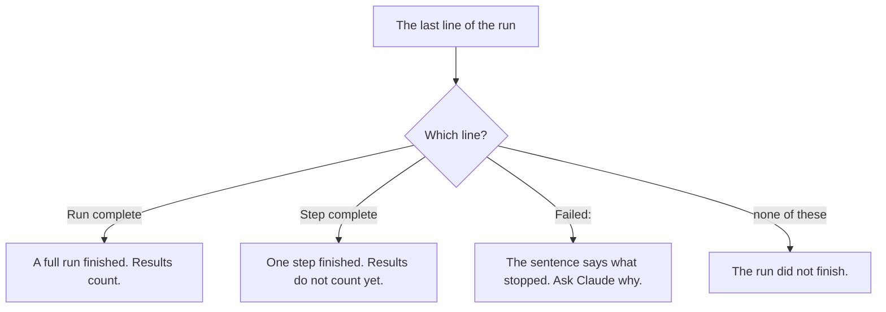

# Messages of a project run

The messages that a project run prints, and who acts after each. `<…>` marks a part that varies. Claude reads the log for you: ask "Did my run finish?"

On a new machine, you first meet [the data root was not found](#before-anything-runs-the-machine-checks). Where a line says to ask Claude for a run, [you start it yourself](../researcher/work-with-r-steps.md#run-the-project-on-windows) on Windows with R or Python steps.

## How a run ends



```text
Run complete. Exhibits and the results page: <folder>
Step complete: <step>
Failed: <step> (r(<code>))
```

After the third line, ask Claude ["The run failed: why?"](../researcher/find-why-a-run-failed.md)

## Before anything runs: the machine checks

A run that stops here deleted nothing and wrote no dated log.

```text
Failed: Stata is not in this project's code folder, so nothing was run: double-click master.do in the project's code folder in Explorer and click Do, or cd into that folder and type  do master.do  (not File > Open).
```

**You:** close Stata and ask Claude to run.

```text
Failed: the data root was not found: the file <file> is missing or empty. Write one line into that file, the full path of the data root on this machine (chair-research-data on Dropbox), as in C:/Users/<you>/Dropbox/chair-research-data (r(601))
```

**You:** tell Claude "It says the data root was not found." and give it the path. Claude writes the file.

```text
Failed: R is not ready for this project, for the reason just above. If no R was found: install R at the version renv.lock names, or, where it is installed in a folder of your own, put the line  global RSCRIPT_PATH <path to Rscript, in double quotes>  into your Stata profile.do (r(601))
```

**Claude:** finds R and restores the packages. See [When master.do says R is not ready](../researcher/work-with-r-steps.md#when-masterdo-says-r-is-not-ready).

```text
Failed: Python is not ready for this project, for the reason just above. With none, Python did not start: once, in the project folder, type  uv sync --frozen  and run again (r(601))
```

**Claude:** checks `uv` and restores Python and the packages. **You:** install `uv` only if the machine lacks it. See [Python steps](#python-steps).

## The pins

```text
Failed: pins.do sets <pin> twice, on lines <line> and <line>. A dataset, a raw delivery or an input of the old folder is pinned on one line: delete the line that is wrong, and run again (r(198))
```

**Claude:** asks which line is right, deletes the other and runs again.

```text
pins.do, line <n>, is not a pin that can be read: <line> . Write it as  global pin_<dataset> "v<N>" ,  global raw_<name> "<source>/<date>"  or  global old_<name> "<file or folder in the old folder>" , with the double quotes.
```

Printed by R and Python steps when a line of `code/pins.do` is malformed. **Claude:** fixes the line in `code/pins.do` and runs again.

```text
Failed: pins.do pins raw/<delivery>, which is not in the data root, <folder>. Check the line in pins.do; if it is right, let Dropbox finish syncing (r(601))
```

**You:** check the delivery's name with the data curator, or wait for Dropbox.

```text
Failed: pins.do reads from the project's old folder (<pins>), and the old folder was not found: the file <file> is missing or empty. Write one line into that file, the full path of this project's old folder on this machine, as in C:/Users/<you>/Dropbox/<old project>; on a machine without the old folder, a co-author's, this project does not run until the curator has delivered the inputs to the data root (r(601))
Failed: pins.do reads from the project's old folder (<pins>), and the old folder was not found: the file <file> names <folder>, which is not a folder on this machine. Write one line into that file, the full path of this project's old folder on this machine, as in C:/Users/<you>/Dropbox/<old project>; on a machine without the old folder, a co-author's, this project does not run until the curator has delivered the inputs to the data root (r(601))
```

**You:** tell Claude "The old folder was not found." and give it the path on this machine, so Claude writes `old-data-folder.txt`. On a machine without the old folder, the project waits until the data curator delivers those inputs.

```text
Failed: pins.do pins old_<name> "<path>", which is not in the old folder, <folder>. Check the line in pins.do and the line of old-data-folder.txt; if both are right and the old folder is on Dropbox, let Dropbox finish syncing (r(601))
```

**You:** check with Claude that `old-data-folder.txt` and `code/pins.do` name the right path, or wait for Dropbox.

```text
Failed: pins.do still reads from the project's old folder (<pins>), which a replication package does not hold: a package is made once the curator has delivered each of these inputs to the data root and its line in pins.do is a raw_ or pin_ line (r(601))
```

**You:** ask the data curator to deliver each input to the data root, have Claude replace its `old_` line with a `raw_` or `pin_` line and rerun everything, and only then ask the data curator to assemble the package.

```text
Provisional: this project reads <n> inputs from its old folder, <folder>: its results stay provisional until each is a delivery in the data root.
```

For one input, the line reads `1 input`. Every result stays provisional until the data curator has delivered each input to the data root and its `old_` line becomes a `raw_` or `pin_` line.

## Loading a dataset

`chair_use` prints these, with slightly other words in an R or Python step.

```text
chair_use: <dataset>/<file> v<N>
```

The file was loaded at this version.

```text
chair_use: pins.do pins no version of <dataset>. Add the line  global pin_<dataset> "v<N>"  to code/pins.do.
```

**You:** say which version the project should read.

```text
chair_use: <dataset> v<N>, which pins.do names, has no manifest in the data root (<folder>).
  Check the version on its line in code/pins.do. If it is right: Let Dropbox finish syncing and run again: it delivers large files late.
chair_use: <dataset> v<N> holds no file <file>.dta here (<folder>). Check the name; if it is right: Let Dropbox finish syncing and run again: it delivers large files late.
```

**You:** check the version or the name in [the data map](../data/data-map.md), then wait for Dropbox.

## During the steps

```text
Failed: the file <file> cannot be erased: close it where it is open, as in Excel, and run again (r(<code>))
```

**You:** close the file, then ask for the run again.

```text
This step needs this project's settings, which master.do sets: from this project's code folder type  do master.do <folder>/<this file>  (after that, its lines also run on their own in the same Stata).
```

A step was started on its own. **You:** ask Claude to run it.

A step can stop with Stata's own message that a command is unknown:

```text
command <name> is unrecognized
```

**You:** tell Claude, which names the package and asks whether to [put it into `ado/`](../researcher/add-a-stata-package.md).

A step can also stop with Stata's own message `grmap not yet activated`, and the advice to type `grmap, activate`. Never type it: in Stata's window it writes to a folder that no run reads. **You:** tell Claude, which activates the command inside the project, with your yes.

## R steps

```text
This project needs R <version> (renv.lock); this is R <version>. Install R <version>; where it is not the R that Stata finds, put the line  global RSCRIPT_PATH "<path to its Rscript>"  into your Stata profile.do.
This clone's R packages are not installed yet: once, in R, in the project folder, type  renv::restore()  and run again.
```

**Claude:** looks for the right R, and restores the packages. You type nothing in R. **You:** install R only if the machine lacks that version.

```text
This project has R steps and no renv.lock: copy what is in code/templates/r-project/ into the project folder; then, once, in R, in the project folder, type  renv::restore()  and run again.
```

**You:** tell Claude what the run says, and it [sets the project up for R](../researcher/work-with-r-steps.md#add-the-first-r-step). You type nothing in R.

```text
renv.lock names no repository called RENV, from which renv installs itself, so a fresh clone on another machine cannot install renv or restore the packages, though this machine runs: put the RENV entry back among the Repositories of renv.lock as code/templates/r-project/renv.lock has it, and run again.
```

**You:** ask Claude to put the entry back.

```text
This R runs on its own, outside master.do: exhibits are overwritten. Results for the paper come from a full run of master.do.
```

You ran a step in RStudio. Report no result from it.

## Python steps

```text
This clone's Python packages are not installed yet: once, in the project folder, type  uv sync --frozen  and run again.
Python packages that uv.lock names are not installed in this clone at the version it names (<packages>): once, in the project folder, type  uv sync --frozen  and run again.
This project needs Python <version> (.python-version); this is Python <version>: once, in the project folder, type  uv sync --frozen  and run again.
```

**Claude:** runs `uv sync --frozen`, which fetches Python and the packages into `.venv/`. **You:** install `uv` only if the machine lacks it.

```text
This project has Python steps and no uv.lock: copy what is in code/templates/py-project/ into the project folder; then, once, in the project folder, type  uv sync --frozen  and run again.
```

**You:** tell Claude what the run says, and it [sets the project up for Python](../researcher/work-with-python-steps.md#add-the-first-python-step).

```text
This project has Python steps and no .python-version that names Python's version, as in 3.14: in GitHub Desktop, discard the change that removed it, or copy it again from code/templates/py-project/
```

**You:** tell Claude. If you deleted or changed `.python-version` by accident, discard the change in GitHub Desktop; otherwise Claude copies it again.

```text
The chair's projects need Python 3.11 or later, and .python-version names <version>: write a later version into it, as code/templates/py-project/.python-version has it.
```

**Claude:** asks which Python version the project is to use, updates `.python-version` and `pyproject.toml`, locks, syncs and checks the fresh copy.

```text
Python does not run in Stata's batch mode on Windows: open Stata, cd into this project's code folder and type  do master.do  there.
```

**You:** [start the run in Stata's window](../researcher/work-with-python-steps.md#run-the-project-on-windows).

```text
This is not the project's own Python (it is <path>), so the packages uv.lock names are not the ones it would use: run the step through master.do, or choose <path> as the interpreter in your editor.
This Python runs on its own, outside master.do: exhibits are overwritten. Results for the paper come from a full run of master.do.
```

You ran a step outside `master.do`. Choose the project's `.venv` interpreter in your editor to try a step, and report no result from it.

```text
<step> did not finish; Python's own message is in the stderr part of its output above, on its last line. With none, Python was stopped, ran out of memory, or the script called sys.exit() or quit().
```

**You:** ask Claude ["The run failed: why?"](../researcher/find-why-a-run-failed.md). If Python's message says `No module named '<name>'`, ask Claude to install that Python package.
