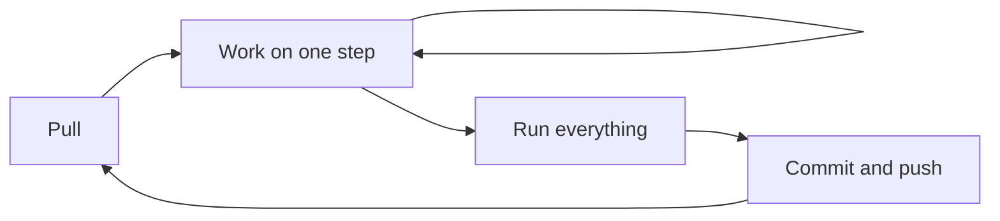

# Follow the daily routine

Open [one session](../start/set-up-your-machine.md#open-your-first-session-and-answer-the-trust-question) on the project each working day. [Words](../reference/words.md) defines pull, step, full run, exhibit, commit and push.

| When | Ask Claude | Check |
|---|---|---|
| You start | "Pull." | One sentence on what came. |
| You want code | "Write a step that merges these two datasets." | The D-number of each choice Claude asked you. |
| You want to see data | "How many rows have no value for 2019?" | The answer. No result changed. |
| You try a step | "Run only the step that makes the main table." | `Step complete: <step>` |
| Before you commit results | "Run everything." | `Run complete` |
| You stop | "Commit and push." | Claude lists the files, and says that it is pushed. |

If you do not know how a run ended, ask "Did my run finish?"

**On Windows, with R steps,** Claude cannot start a run: [you start it yourself](work-with-r-steps.md#run-the-project-on-windows).

**Untested on Windows.** Until Claude's git works there, [GitHub Desktop's buttons](fix-a-rejected-push-or-a-conflict.md#if-claude-cannot-use-git-on-your-machine) stand in.

## When Claude proposes a full run first

Claude proposes a full run, and you decide, in three cases.

- Before one step, if an earlier step or [a version](../data/versions-and-pins.md) changed since your last full run.
- After a pull that brought code, versions or results.
- Before a commit, if results changed and no full run made them.

One case has no question. If a pull on the way to a commit brings code, versions or results, Claude runs everything first. Its instructions disagree on whether it lists the rewritten exhibits again before that commit, so look at the commit on github.com.

## What a single step does not tell you

A single step runs on the working files as they were: the files in `temp/` that earlier steps saved. So it cannot show whether other results changed. Report a number only after a full run. See also [What never to do](../reference/never-do.md).
