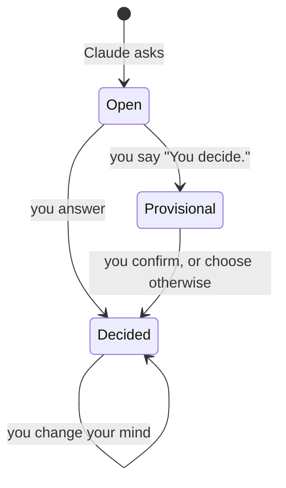

# Record a scientific choice

A scientific choice is yours: which sample, which threshold, how to cluster. Claude writes each one into `decisions.md`, the project's record.

## Answer in plain words

Claude asks for each choice that a task needs, and proposes options. Answer in the conversation. Claude writes a row under **Decided** with your words quoted, your name and the date, and tells you its number, such as `D3`. It records a choice that you state unasked in the same way.

**Claude will ask you.** Your name, once. It never takes a name from the machine or from git.

Your colleagues see the row once `decisions.md` is committed and pushed.

## Leave a choice open, or hand it to Claude

Without your answer there is no decision. The question stays under **Open**, and the code that needs it waits.

If you say "You decide.", Claude decides, and writes the row under **Provisional** with its reason and the other options. The checklist requires that no provisional row remains at submission.

## Change your mind

Say so. Claude adds a dated row with the same D-number, and the old row stays.

## Record a licence yourself

**Only you do.** An author writes a licence, or any choice that binds the authors, into `decisions.md` by their own hand. Claude leaves it under **Open**.

**Check.** `decisions.md` holds the row, and the step that applies it names the number on its `DECISIONS APPLIED` line.
