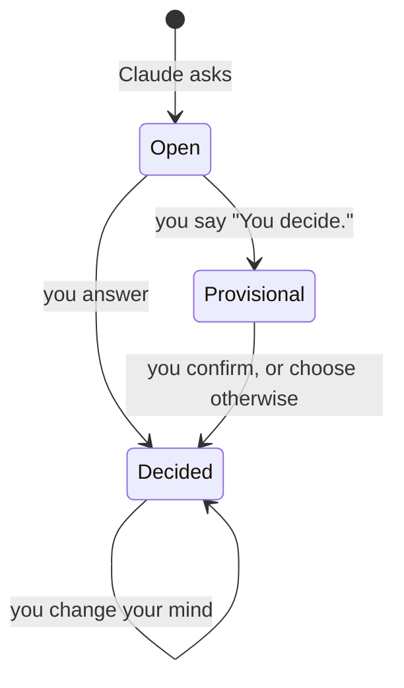

# Record a scientific choice

A scientific choice is yours: which sample, which threshold, how to cluster. Claude writes each one into `decisions.md`, the project's record.

## Answer in plain words

Claude asks for each choice that a task needs, and proposes options. Answer in the conversation. Claude writes a row under **Decided** with your words quoted, your name and the date, and tells you its number, such as `D3`.

It records a choice that you state unasked in the same way. A guess, a default, silence or "whatever is usual" is not a choice: Claude asks again.

**Claude will ask you.** Your name, once. It never takes a name from the machine or from git.

Your colleagues see the row once you commit and push `decisions.md`.

## Leave a choice open, or hand it to Claude

Without your answer there is no decision. The question stays under **Open**, and the code that needs it waits.

Only if you hand the question over explicitly, as in "You decide.", does Claude decide. It writes the row under **Provisional** with its reason and the other options, and the code goes on. The choices of an old project that you [move in](move-an-existing-project-in.md) and do not answer also go under **Provisional**, "kept from the old project", so its code runs.

Before submission, the checklist asks you to confirm or overturn each provisional choice, in your project and in the builds of the datasets it reads. Confirm one in plain words: Claude adds a row under **Decided** with the same D-number.

## Change your mind

Say so. Claude adds a dated row under **Decided** with the same D-number, and the old row stays as it was recorded.

## Record a licence yourself

**Only you do.** Write any licence, or any choice that binds the authors, into `decisions.md` yourself. Claude leaves it under **Open**.

**Check.** `decisions.md` holds the row, and the step that applies it names the number on its `DECISIONS APPLIED` line.
