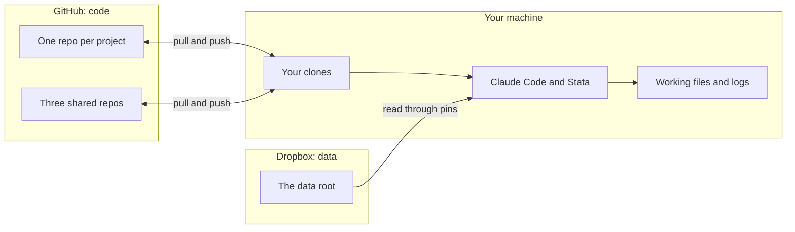
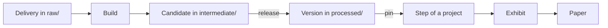

# How the platform fits together

The platform has three places, one path for data, and one rule for who decides.

## Three places: GitHub, Dropbox and your machine

Code lives on GitHub, one repo per project. Three shared repos serve everyone: `project-template` starts every project, `data-processing` makes the shared datasets, and `handbook` holds these pages. A later change to the template reaches a project only when you ask Claude to [update it from the template](../researcher/update-from-the-template.md).

Data lives on Dropbox, in one folder called [the data root](../data/data-root.md). No data file enters a repo.

Your machine holds your clones, your copies of the repos. Claude Code and Stata run there.

## How data moves from a delivery to a table in the paper

A provider's files arrive as a delivery and stay as received. A build cleans them into a dataset, which the data curator releases as a version. A project names the version it reads on one line, its pin. Its steps write the paper's exhibits: its tables, figures and numbers.

## Why it is built this way

- **Code and data are kept apart.** Code is small and changes daily. Data is large and must not change by accident. Git suits only the first.
- **Every run starts from `master.do`.** One way in means one set of checks, whether the steps are in Stata or in R.
- **Claude does the steps and you decide.** Each routine is written once, as an instruction that Claude follows on every machine. [Working with Claude](../claude/working-with-claude.md) says how you keep control.
- **Branches, servers and database software are left out.** Each would need someone to look after it. The price is a few failures that no check catches, named under **What can go wrong.**
